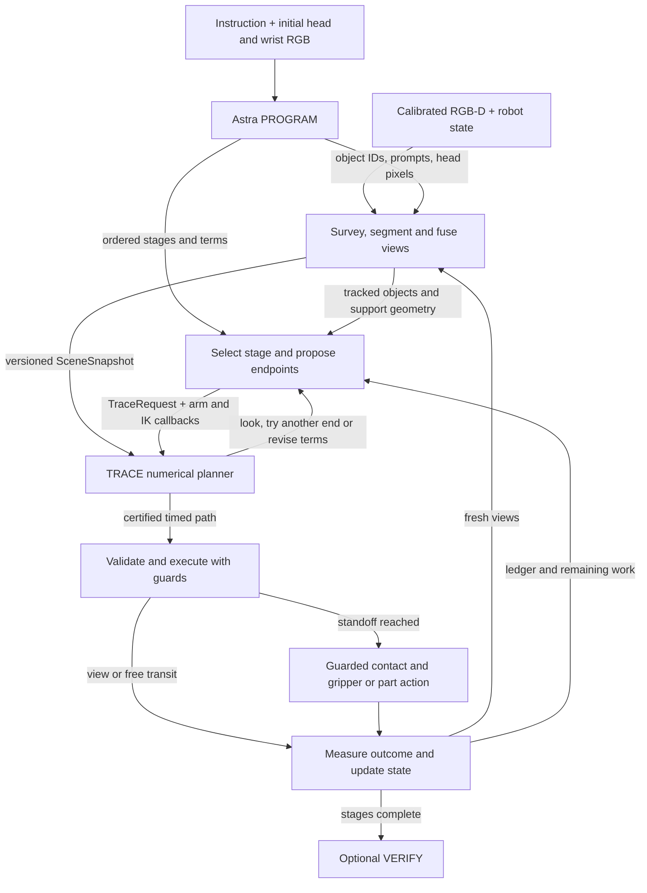

# Agentic TRACE for tabletop manipulation

Given an instruction such as “put both cans in the basket,” Agentic TRACE decides which objects to move, locates them in camera images, and controls a simulated Franka Panda arm until the task succeeds or the attempt ends. Its inputs are the task text, calibrated color and depth (RGB-D) images from head and wrist cameras, robot measurements and a model of the arm and gripper. Its immediate outputs are hand-pose, posture and gripper commands. The run also records what the robot observed, which paths it checked, what it attempted and how the benchmark scored the result. [Illustrated method guide (PDF)](METHOD_DIAGRAM.pdf)

The implementation combines a **CP-5 manipulation harness** (`src/atrace`) with **TRACE**, short for *Tolerance-typed Residual Programs with Annealed, Certified Search* (`src/traceplan`). In the harness, a vision-language model called **System 1** writes an ordered program. **System 2** grounds its object references in the scene, chooses grasps or device actions and asks TRACE for individual contact-free motions. TRACE combines geometric goals, language-derived constraints and observed obstacles into a set of numerical tests. It returns a timed path that passed those tests, or a result explaining what the harness can try next. The harness owns model calls, scene updates and physical interaction. For a grasp, for example, TRACE plans to a point just before contact, and the harness uses force and finger feedback to finish the pickup. [Implementation overview](README.md) · [Method and terminology](TRACE_method.md) · [Integration design](DESIGN.md)

## How the modules work together

| Module | Inputs it uses | Output and next consumer |
| --- | --- | --- |
| Episode runner and robot interface | Task ID, episode index, simulated robot and cameras | Task text, calibrated observations and measured robot state for the harness. The runner also starts independent scoring. |
| Semantic program and wrist survey | Instruction and initial RGB views for System 1. Calibrated depth and robot state for System 2. | System 1 returns object IDs, pixel references, ordered stages and optional constraints. Concurrently, the wrist survey adds views for grounding. |
| Perception and scene memory | Object descriptions, head-image pixels, RGB-D views, camera calibration and robot masks | Tracked object geometry and a versioned obstacle map. Stage skills query the objects, and TRACE reads a snapshot of the map. |
| Transfer and actuation skills | Current stage, object geometry, available space and gripper state | Ranked grasp, placement or part-approach poses. The survey and view routines also generate camera poses. For a contact approach, the skill also supplies its direction and available lateral clearance. |
| TRACE motion service | Start state, candidate ends, terms with tolerances, scene snapshot, body geometry, and robot feasibility callbacks | A timed and checked path with its validity conditions, or a diagnosis that can lead to another view, endpoint or stage plan. |
| Execution, stage checks and recovery | Timed poses, planned posture, sensor feedback and local contact routines | Physical commands and measurements of the result. The ledger informs later stages, semantic repair and verification. |
| Evaluation and replay | Executed simulator steps, independent goal and collision checks, and saved requests and snapshots | Episode scores, event logs and data for inspecting individual planning decisions. |

The standoff and contact branch applies when a skill intends contact. A camera move can finish with a new observation as soon as the robot reaches its viewing pose. A single transfer can therefore make several TRACE requests, for example to look at the can, approach it, lift it after grasping and carry it to the basket.

## Episode inputs and robot interface

| Input | Form | Consumer and purpose |
| --- | --- | --- |
| Task and episode | A LIBERO task identifier and episode index select an environment, initial state and manifest. The manifest supplies the natural-language instruction. An optional operator hint accompanies the instruction. | The runner sets up the episode. System 1 uses the instruction and images to write the program. |
| Head and wrist cameras | Each default 512 × 512 frame contains RGB color, metric depth along the optical axis, pinhole intrinsics, a camera-to-world transform, a robot-only mask, the capture step and joint state. The fixed camera is `agentview`. The eye-in-hand camera is `robot0_eye_in_hand`. | System 1 receives the two RGB images. System 2 uses calibration and depth to turn a pixel into a point in metres, fuse views, place the wrist camera and check outcomes. |
| Proprioception and touch | Seven arm joints, two finger encoders, joint velocities and wrist force/torque. The interface obtains the hand pose from forward kinematics and derives the finger opening from the encoder readings. | The motion executor tracks the path, detects unexpected contact or a lost grasp and provides measurements to the stage executive. |
| Robot and controller description | The Panda kinematic chain, joint limits, robot collision geometry and controller settings. | The harness measures pad geometry at startup. It uses the model for inverse kinematics, swept-body clearance and controller prediction. |

`SimRobot.step` sends an absolute hand position and orientation plus a gripper command to the operational-space controller. It can also update the arm’s null-space posture reference, which steers the elbow while tracking the same hand pose. The episode runner owns the benchmark success predicate and physical contact monitor. Their readings go to scoring. [Episode runner](scripts/run_episode.py) · [Camera frames and robot I/O](src/atrace/sim_iface.py) · [Robot model](src/atrace/robot_model.py)

## The episode executive and semantic program

The executive takes the initial head and wrist observations, estimates the table height, builds a preliminary map and submits an asynchronous `PROGRAM` request. While the model reasons, the robot surveys clusters of above-table points using the wrist camera. These additional views can reveal a surface that the head camera missed. Once the program arrives, grounding joins the **original** head pixels chosen by the model to the survey geometry. This ordering lets language reasoning and data collection overlap without changing the image that a pixel refers to. [Harness startup, survey and grounding](src/atrace/harness.py)

System 1 uses the Astra client to return structured JSON. Each object has an ID, visual description, role, segmentation prompts and a head-image pixel. A part may name its parent fixture. Each stage specifies either a `transfer` with a reference and spatial relation, or an `actuate` with a part, motion and desired state. A particular compartment can be named with a placement pixel. A visible effect such as a burner lighting can have its own observation pixel. The program also includes a finish condition. The validation step checks references, normalizes prompts and pixels, and handles invalid levels. With multiple compiles, the first program supplies the stage structure, and agreement across compiles supplies term confidence. One compile is the default. [Program schema and validation](src/atrace/program.py) · [Model requests and call budget](src/atrace/llm.py) · [Model client authentication](src/atrace/chatgpt_auth.py)

## Grounding, mapping and snapshot export

1. **Bind a word to a surface.** SAM 3.1 runs the object’s text prompts against the RGB frame. The harness prefers a mask covering the pointed pixel, then tries nearby masks. It removes robot pixels and back-projects valid depth through the chosen mask. When segmentation misses, it can recognize a point on the table or grow a connected depth region around the seed. A grounded ID persists across views and can be reused after repair. [Segmenter and cache](src/atrace/segment.py) · [Grounding logic](src/atrace/harness.py)
2. **Fuse views into object and scene geometry.** The harness projects each object’s current 3D points into wrist views, matches detections by mask overlap and merges compatible points. An `ObjectModel` stores surface samples, footprint, height map, support height, observation history and held state. The `SceneMap` combines the views on a 1 cm grid, tracks occupied, free and unknown cells, and keeps a finer surface cloud for nearby clearance checks. Labels identify known objects. Unnamed geometry still participates as an obstacle. A height histogram seeds the visual table plane, then the bases of above-table clusters refine the support estimate. [Multi-view fusion, object models and near-field distances](src/atrace/perception.py) · [Support estimate and map rebuild](src/atrace/harness.py)
3. **Publish the planning scene.** A versioned `SceneSnapshot` contains occupied and unknown grids, labels and occlusion information, the analytic table height, sampled named entities, keypoints, positional covariance and a live exact-distance query. An entity with a wrist observation receives the 3 mm uncertainty floor. Otherwise the model also includes a 6 mm component in quadrature. The scene carves space already occupied by the robot and uses explicit free-space assumptions for selected overhead and out-of-view areas. A held object leaves the static obstacle set and travels with the gripper as a payload. These details determine what a clearance certificate can establish about the observed scene. [Snapshot export](src/atrace/snapshot.py) · [Map assumptions](src/atrace/perception.py) · [Hand and payload spheres](src/atrace/body.py)

## Turning a stage into reachable endpoints

**Transfer.** For a pickup, the harness can look at an unseen side and then look down from above. The grasp generator samples candidate centres, yaws, depths and inclinations on the object. It seeks opposing surfaces that both pads can contact while the fingers clear adjacent material and the supporting surface. The executive filters candidates using inverse kinematics and clearance. It hands the motion planner a target pose, approach direction, lateral tolerance and joint suggestion. TRACE can end the free move at a standoff. A guarded local descent then closes the remaining gap. Finger opening during closing and after lift supplies evidence that the object is held. The payload geometry is attached in the gripper frame for the carry segment. [Grasp candidates](src/atrace/manip.py) · [Transfer and reach sequencing](src/atrace/harness.py)

For placement, `in` uses an estimated rim, floor and compartment geometry. `on` uses a support region. Directional relations use the reference and head-camera orientation. Candidate testing combines the rotated payload footprint, support, surrounding obstacles, requested placement pixel and available room for later placements. The harness carries the payload to a preplacement standoff, lowers it under a support-contact guard, opens the fingers, retreats and observes the landing. A local relation check can record an unverified result when the object is hidden. A negative measurement can trigger a new grasp and placement. If a carried item drops, the harness can use a fresh view near the drop location to reacquire it. [Placement regions and scoring](src/atrace/manip.py) · [Placement, relation checks and reacquisition](src/atrace/harness.py)

**Actuation.** For a knob, handle, door or drawer, the inputs are the observed part, its fixture when available, and the program’s motion and goal. The articulation module fits candidate mounting planes around the part and estimates an outward normal and axis. The executive uses that frame to generate a grasp or press, reach a standoff and enter guarded contact. For rotation it turns about the estimated axis. For push or pull it translates along the mounting direction and adjusts to measured displacement, with checks for stall, force and grip. Fresh views can show how far the front stands out from its fixture or whether it is flush. For a named visual effect, the harness can detect an image change and ask System 1 to confirm it from before-and-after head views. The ledger records the evidence available for the stage. [Plane fitting, state estimation and compliant motions](src/atrace/articulate.py) · [Actuation executive and effect checks](src/atrace/harness.py)

### Robot geometry and whole-arm checks

The robot model computes forward kinematics, Jacobians and inverse kinematics, samples the collision surfaces of each link and measures gripper dimensions. Pose transforms convert between camera, world, link and gripper coordinates. The body adapter represents the palm, fingers, terminal link and any held object as spheres fixed to the gripper. For the rest of the arm, the controller model rolls out a sequence of joint configurations along the pose path and reports reachability, joint discontinuities, limits and clearance. This supplies TRACE with the robot-specific arm and inverse-kinematics callbacks it needs to check a candidate. CP-5’s joint-space planner can supply a seed after the straight path fails, or run as the standalone motion backend. [Robot model](src/atrace/robot_model.py) · [Frame transforms](src/atrace/geometry.py) · [Body and controller callbacks](src/atrace/body.py) · [CP-5 planner](src/atrace/motion.py)

## How TRACE plans one contact-free movement

### The contract between the harness and planner

`TraceMotion` takes a segment such as `to_pregrasp` and builds a `TraceRequest` from the measured start pose, seven arm joints, finger opening, held-object ID, ranked end candidates, numerical terms, body spheres, margins, speed limits, seed and time budget. It passes a versioned `SceneSnapshot` alongside the request. The snapshot describes perceived geometry. Two harness callbacks supply the robot-specific answers to “Can the arm reach this pose?” and “Can it follow this whole candidate path?” This interface lets the same service run on a live episode, saved data or a synthetic scene. Position is in metres, rotation in radians and time in seconds. Poses use the world frame. The hand and payload sphere centres use the grip-site frame. [Contract](src/traceplan/contract.py) · [Live adapter](src/atrace/tracemotion.py) · [Robot callbacks](src/atrace/body.py)

A transit endpoint is a desired hand position and orientation. For a movement toward contact, the harness supplies the intended contact pose, a unit approach direction, a lateral tolerance and an object ID. TRACE backs up along that direction to a *standoff*. Its default distance combines axial position uncertainty, slow-speed tracking allowance, finger guard clearance and a 5 mm allowance, clipped to 20–100 mm. A separate lateral check asks whether uncertainty across the approach plus tracking error fits within the contact window. If every candidate fails this check, TRACE can request a closer look. At the configured perception floor, the harness delegates the remaining lateral alignment to contact and the service records that choice. The service also supports solving a free endpoint at or above a named entity. The live harness normally supplies explicit candidates. [Endpoint construction](src/atrace/harness.py) · [Standoff and window rules](src/traceplan/diagnose.py) · [Candidate handling](src/traceplan/service.py)

For approach direction $a$ (a unit vector), target position covariance $\Sigma$ and axial standard deviation $\sigma_a = \sqrt{a^\mathsf{T}\Sigma a}$, the contact point $p_c$ becomes a standoff endpoint $p_c - d a$. Using millimetres, the live defaults give the following calculation.

$$
d = \operatorname{clip}(1.64\,\sigma_a + 5.1 + 5 + 5,\ 20,\ 100).
$$

Here 5.1 mm is the translational tracking allowance used for the standoff at the minimum planning speed. The next 5 mm is the finger guard, and the last 5 mm is extra approach room. A target with a 3 mm standard deviation gives 20.02 mm, the distance recorded for the soup-can grasp below. [Standoff calculation](src/traceplan/diagnose.py) · [Live margins](src/atrace/levels.py) · [Recorded request](runs/e2e_t00_ep000_trace4/trace/trace.jsonl)

### Translating intent and the map into numerical tests

The harness owns the level table. A stage can request `upright` for a carried object, for example. The compiler turns that level into a tilt bound of 10° with a 3° tolerance. It applies tilt while carrying the specified object, a clearance instruction to the named obstacle, and an approach instruction to a matching contact segment. The harness adds its own hand, finger, link and payload clearances, analytic table-plane clearance, reach limit, unknown-space requirement and smoothness preferences. Occupied-space margins include the per-step guard distance, a minimum tracking allowance and a perception allowance. Within 5 cm of a tight start or end pose, the clearance rule can lower its required margin to the clearance measured at that endpoint minus 1 mm. This lets the hand leave or approach a tight pose. The known-space requirement can be relaxed to slow, guarded motion where it is violated. [Level table and margin rules](src/atrace/levels.py)

A `Term` names a geometric measurement, its scope (whole path, terminal pose or interval), tolerance `sigma`, and role. `safety` and `require` must pass certification. `prefer` ranks feasible paths. The primitive library evaluates pose and axis errors, clearance, tilt, approach direction, reach and smoothness, among other quantities. A clearance residual is the required margin plus the body's sphere radius minus the distance from the sphere centre to the obstacle. A positive residual measures the shortfall. The scene module builds differentiable signed-distance grids from occupied or unknown voxels, with optional selection or exclusion by entity. Search can blur the grids. The final check uses the live near-field distance callback for ordinary obstacle clearance when available, and unblurred grids for entity-specific and unknown-space queries. [Primitives](src/traceplan/primitives.py) · [Scene fields](src/traceplan/scene.py)

The residual-program module checks references, units and role permissions. For a language term such as “keep the can upright,” it checks that changing the candidate path can change the measured tilt. Other probes test numerical range, whether moving the scene and path together preserves the result, and whether a required path condition holds at the fixed start. Uncertainty changes how selected terms enter search. An attraction term can receive a wider search tolerance, while a repulsion term can increase its required clearance. The final report evaluates against the original acceptance tolerance. [Program checks and uncertainty fusion](src/traceplan/program.py)

### Constructing and searching the path

`TraceService.plan` screens terminal poses for penetration and reachability, then ranks survivors by terminal-term violation, preserving the harness order for ties. By default it keeps up to two. For each candidate, the path is a clamped cubic spline in rigid-body pose space, SE(3). SE(3) represents a 3D position and orientation together. Position follows a B-spline. Its orientation follows the start-to-end rotation with smooth rotation-vector offsets. Fixed endpoints make a straight translation with interpolated rotation the cheapest candidate to try. This route goes immediately to certification. [Service](src/traceplan/service.py) · [Pose spline](src/traceplan/spline.py) · [Rotation operations](src/traceplan/se3.py)

After an eligible straight-path failure, the adapter asks the CP-5 joint-space planner for a seed. That planner tries a direct joint path, lift routes and a bidirectional sampling planner (RRT-Connect). The adapter converts the result into joint, position and rotation samples. If CP-5 finds no route, the adapter interpolates from the starting joints to the first goal as a fallback seed. In `v0`, TRACE checks the supplied path. In full `trace` mode, search also starts from a straight seed and can generate up to three diverse weighted A* routes through a coarse occupancy grid. Blocked cells cost more, so a seed can cross an obstacle and still be a useful starting guess. Every accepted path must subsequently pass certification. `cp5` is a separate episode mode that uses the original harness motion path. [Adapter and modes](src/atrace/tracemotion.py) · [Search](src/traceplan/search.py)

At each of four default levels, the objective scores sampled paths against the terms. It robustly penalizes preference errors, uses quadratic smoothness costs and updates augmented-Lagrangian multipliers for hard terms. Model Predictive Path Integral (MPPI) sampling explores batches of smooth perturbations, giving lower-cost samples more weight. Limited-memory BFGS (L-BFGS) then uses gradients to refine the controls. Between levels the search retains the better seeds, reduces field blurring and tolerance scaling, and increases the spline controls from 4 to 5 to 7 to 11. Inserting knots preserves the previous curve as the starting point for refinement. The default search score uses 32 sampled poses. The service attempts certification in score order. Its time budget governs search and can be exceeded by work already underway or certification. [Objective](src/traceplan/objective.py) · [Optimizers](src/traceplan/solvers.py) · [Search schedule](src/traceplan/search.py)

### Certifying the geometry and assigning times

The certifier samples the path at 128 poses by default. Every hard term's maximum normalized violation over its scope must be at most one. For an equality this is the residual vector's norm divided by its tolerance. For an inequality it is the largest positive component divided by its tolerance. The harness then rolls its arm model along the poses from the measured joints and checks pose reachability, joint limits, continuity, and whole-arm clearance from obstacles and the table. A feasible hand path can fail because the elbow passes too close to an obstacle. [Certification](src/traceplan/certify.py) · [Dense residual report](src/traceplan/objective.py) · [Whole-arm check](src/atrace/body.py)

The retimer uses the remaining clearance to limit the local speed and angular rate. It applies acceleration limits forward and backward with the endpoints at rest, then samples position, orientation and the arm posture at the control period. The live defaults are 50 ms per sample and a maximum translation speed of 0.40 m/s with an empty hand or 0.20 m/s while carrying. At each sample the live retimer computes the positional tracking allowance in metres as $0.004 + 0.022v + 0.003\omega$, with translation speed $v$ in m/s and angular speed $\omega$ in rad/s. A rotation in place therefore also consumes clearance. `Timed` contains timestamps, positions, rotations, joint references, speeds and one allowance per sample. A certificate is evidence about the sampled path, model and scene version. Runtime tracking and contact measurements check what actually happens. [Retiming](src/traceplan/retime.py) · [Live limits](src/atrace/levels.py) · [Response fields](src/traceplan/contract.py)

### How results change the next action

| Service result | Evidence and harness response |
| --- | --- |
| `certified` | A timed path, selected end, standoff, validity conditions and term report. The harness checks that the certificate is still valid and then runs the guarded executor. A dropped payload goes to stage recovery. |
| `conflict` | After a completed search, the service temporarily demotes individual candidate `require` terms and tests whether the other hard terms can pass. A quote identifies a term and the value it would need. The harness applies a previously allowed relaxation if all quoted changes fit. Otherwise it passes the evidence to stage repair. Only required terms are eligible for a relaxation quote. |
| `not_certifiable` | The lateral endpoint check or an uncertain obstacle near a small clearance shortfall identifies an entity to inspect. The harness may take up to two closer looks per move, rebuild perception, discard stale seeds and retry. |
| `no_path` | No candidate survived screening, or the attempted paths did not certify within the search performed. The caller can try another pose or strategy. A budget-limited failure also gets this result. |
| `program_error` | Findings identify invalid terms. The adapter removes offending language terms, records them for later repair and resubmits. A rejected harness-authored term raises an implementation error. |

The service logs its responses and the adapter records which reaction the executive took. [Decision logic](src/traceplan/service.py) · [Diagnosis](src/traceplan/diagnose.py) · [Reactions](src/atrace/tracemotion.py) · [Execution guard](src/atrace/guard.py) · [Synthetic fixtures](src/traceplan/synthetic.py)

## Executing motion and recovering from failure

Before executing a certified path, the adapter rechecks the held entity, starting joints and map version or change within the swept tube. The executor follows time-indexed pose and posture commands on the 50 ms control grid. After each trajectory command it measures the hand’s distance to the local path, checks the joint and geometry guard, tests for unexpected contact, and checks finger opening while carrying. The contact detector compares actual hand displacement with a one-step free-motion prediction and uses directional wrist force as additional evidence. A guard stop records the defect and can trigger a fresh observation and one retry. Near-contact departures have a separate fallback to the local straight-line move. [TRACE motion adapter](src/atrace/tracemotion.py) · [Timed executor](src/atrace/motion.py) · [Per-step guard and contact detector](src/atrace/guard.py)

The executive appends each stage outcome and its evidence to a ledger. A failed grounding or exhausted stage retry can trigger `REPAIR`, which receives current images, the previous program, the ledger and the measured failure. It can repoint an object, reorder remaining stages or revise a term. The harness validates and grounds the replacement. After ordinary stage completion, optional `VERIFY` reads the current views, program and ledger and can prompt one pass of remaining work. Defaults in the episode runner include a limit of eight model calls, a 900 s wall budget and final verification enabled. The harness allows up to two repairs by default. The benchmark can terminate the episode sooner, at the first control step on which LIBERO reports goal success. [Repair and verification loop](src/atrace/harness.py) · [Independent episode evaluation](scripts/run_episode.py)

## Worked example · two cans in one basket

In the saved `t00`, episode 0 run, the instruction was “put both the alphabet soup and the tomato sauce in the basket.” The runner used the TRACE motion backend with a 2,000 ms budget per request and one PROGRAM compile. It also saved the evaluator’s scene at each request. These settings belong to this recorded run. [Run arguments](runs/e2e_t00_ep000_trace4/args.json) · [Episode summary](runs/e2e_t00_ep000_trace4/summary.json)

| Handoff | What happened in this episode |
|---|---|
| From survey to a grasp | The first straight camera move returned `no_path`. A second request on the same scene version found a certified camera path by search. After further views, the grasp generator proposed 80 candidates for the soup can. A geometry prefilter kept 50 and the harness selected one. |
| From certified transit to contact | Request `0008_to_pregrasp` used map version 6, an empty hand, one candidate and 12 terms. The straight path certified in 625 ms with a 20.02 mm standoff. The executor followed it during steps 187–218. The harness then approached and closed the gripper. At step 243 its measured opening was 61.1 mm against a predicted 63.0 mm. |
| From grasp to carry | The harness built a payload model and removed the can’s old points from the map. Request `0009_lift` used version 7, held entity `o1` and 15 terms. The lift executed during steps 244–274, followed by a grip check, a trip to the basket and a placement. |
| From failed placement to repair | With the sauce can already held, three attempts to reach a pre-placement pose ended in `no_path`. The stage ledger recorded `placement_failed`. The REPAIR call specified a pixel in the basket’s free front-left interior. The harness selected a new placement and request `0029_to_preplace` certified on version 22. The timed move ended at step 790, the local descent ended at 806, and LIBERO reported success at 815. |

The episode used two model calls, PROGRAM and REPAIR, in 175.5 seconds of policy wall time. Of 29 trajectory requests, 19 certified and executed and 10 returned `no_path`. All 19 executions completed without a guard stop or tube exit. The saved-scene check found zero violating paths among the 19 it checked. The full episode’s collision monitor recorded can–basket and can–can contacts, so `scene_collision_free` was false and `added_obstacle_collision_free` was true. [Event log](runs/e2e_t00_ep000_trace4/events.jsonl) · [TRACE requests](runs/e2e_t00_ep000_trace4/trace/trace.jsonl) · [Execution measures](runs/e2e_t00_ep000_trace4/trace/measures.json) · [Episode summary](runs/e2e_t00_ep000_trace4/summary.json)

## Reading a run and checking the method

| Artifact | Question it answers |
|---|---|
| `args.json` and `summary.json` | Which configuration ran? Did the evaluator detect success? The summary also records the final program, stage ledger, repairs, model calls, timing and motion counts. LIBERO can detect success during a control step before the harness finishes its own verification. |
| `events.jsonl` and `trace/trace.jsonl` | What did the harness observe and do? Join these files by request ID to connect a stage, map version, planner result, recovery reaction and executed control-step range. |
| `trace/req_<id>.pkl` and `trace/snapshots/v<version>.npz` | What did the planner see? Each pickle stores the request and response. The snapshot stores the measured grid and entity data. Replay can reuse recorded IK and arm-check answers for matching queries. |
| `collision.json` and optional `trace/true/<id>.npz` | What did the evaluator see? The episode runner monitors simulator contacts independently. With `--true-scene`, it also saves sampled object geometry for later comparison with the perceived scene. |

The separate development runner can substitute a simulator-derived program via `s1_stub.py` for development scenes. Its `offline` setting disables live model calls. [Episode runner](scripts/run_episode.py) · [Development runner](scripts/dev_episode.py) · [Development program fixture](scripts/s1_stub.py)

`trace_measures.py` aligns execution windows with recorded contact onsets and reports solve times, fast-path share, recovery reactions, guard stops and tube exits. Its optional geometric recheck compares hand-associated and payload spheres with sampled, unsigned simulator surface distances and the table, applying the endpoint-zone rule. The live certification also checks the arm through a controller rollout. `trace_replay.py` reruns requests from disk, compares the result, selected endpoint and sampled positions, and counts unmatched callbacks. Replay uses saved grid geometry and permissive answers for unmatched callbacks, which can change the outcome. [Measures](scripts/trace_measures.py) · [Evaluator geometry](scripts/true_scene.py) · [Replay](scripts/trace_replay.py)

`trace_bench.py` creates requests for six synthetic scenes to compare solver pairs, seeding, continuation, hard-constraint handling and spline resolution. Its program-check experiments inject invalid references, unit errors, missing attachments, fixed world coordinates and impossible start constraints. The benchmark builds analytic scenes, supplies hand and payload models and uses a simplified arm callback. For behavioral examples, the test suites cover the planner contract, retiming and solver behavior, and the online harness’s reactions using offline fixtures. [Synthetic scenes](src/traceplan/synthetic.py) · [Benchmark](scripts/trace_bench.py) · [Planner tests](tests/test_traceplan.py) · [Solver and retiming tests](tests/test_solvers_retime.py) · [Harness tests](tests/test_atrace_offline.py)
